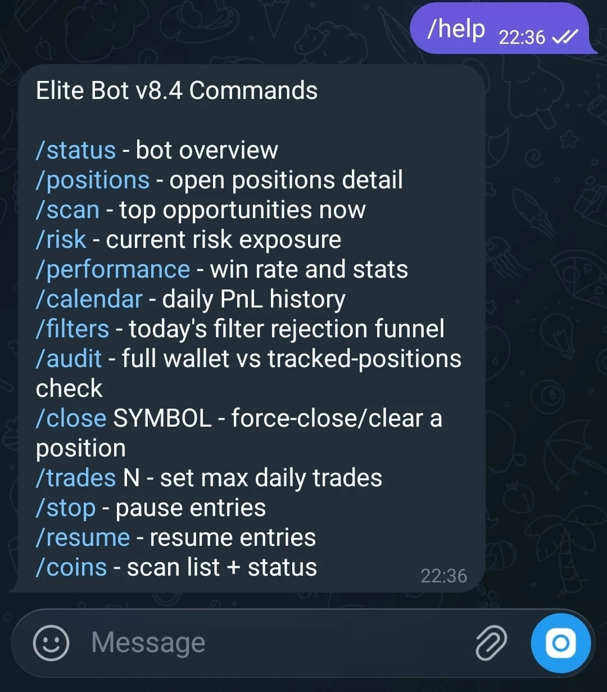
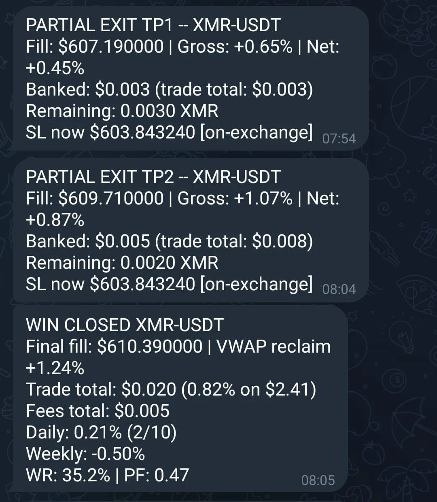
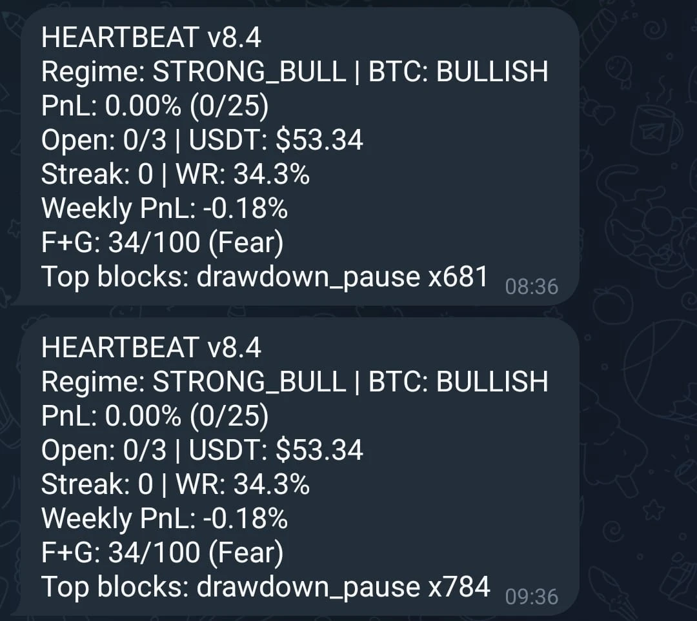
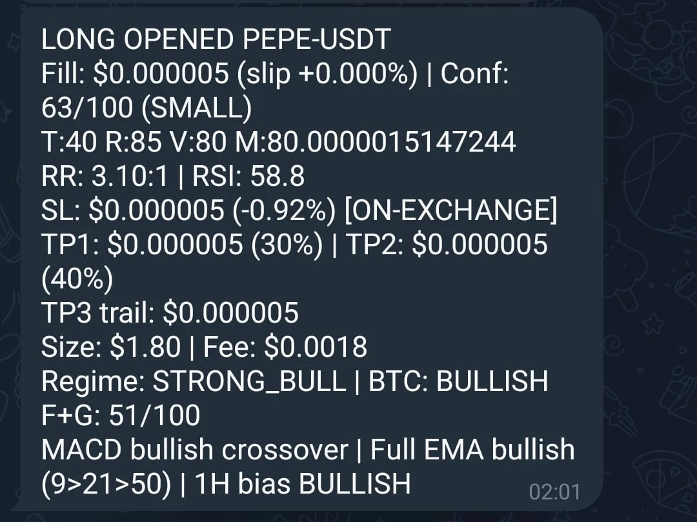

# Crypto Trading Bot — v8.4 "Volume"

A single-file, self-hosted spot-trading bot for KuCoin. It scans a hybrid
universe of coins, scores entries with a weighted confidence model, manages
risk with ATR-based stops/targets and exchange-side stop orders, and reports
everything to Telegram. Includes a standalone backtester, a trade-log
analyzer, and an API connection diagnostic.

Current profile (`v8.4 "Volume"`) is an **aggressive, unvalidated live-test
configuration** — see the disclaimer at the bottom before running it with
real funds.

## Features

- **Hybrid universe** — a fixed set of core coins plus the top movers by 24h
  $ volume, with a liquidity floor and no stablecoins/leveraged tokens.
- **Weighted confidence score** — technical / regime / volume / momentum
  components combine into a 0–100 entry score, gated by a minimum confidence
  and a blended risk:reward threshold.
- **ATR-based risk management** — stop-loss and a 3-tranche take-profit
  ladder (40/35/25 split) sized from ATR, early break-even once in profit,
  ATR trailing on the runner, and a time-based exit for stale trades.
- **Exchange-side stop orders** — the stop lives on KuCoin itself, so it
  survives a VM reboot, network loss, or a hung loop; synced on break-even
  moves and trailing.
- **Wallet audit** — an independent check of every non-zero balance against
  tracked positions (not just symbols the bot believes are open), so an
  untracked holding is never left unprotected.
- **Dynamic equity sizing** — position size follows live equity with a
  hard per-position cap, a portfolio-heat limit, and a drawdown pause once
  equity falls a set % below its peak.
- **Telegram control** — live status, positions, risk, performance,
  calendar, filter-funnel diagnostics, wallet audit, and commands to
  force-close a position, change daily trade limits, or pause/resume entries.
- **Persistence** — state and trade log survive restarts, with hourly CSV
  and state backups.

## App samples

| Telegram commands | Trade lifecycle (partial exits → close) |
| --- | --- |
|  |  |

| Periodic heartbeat | New position opened |
| --- | --- |
|  |  |

## Running it

Requires Python 3.10+ and a KuCoin account with API keys (Spot Trading,
Margin Trading, Transfer permissions).

```bash
# 1. Set up the environment
python -m venv .venv
.venv\Scripts\activate        # Windows
# source .venv/bin/activate   # macOS/Linux
pip install -r requirements.txt

# 2. Configure credentials
cp .env.example .env
# edit .env with your KuCoin API key/secret/passphrase and
# (optionally) a Telegram bot token + chat id for alerts/commands

# 3. Run the bot
python trading_bot_v8.4.py
```

Other scripts:

```bash
python test_api_connection.py   # verify API credentials/connectivity
python analyze_trades.py        # summarize a trade_log.csv
python backtesting.py           # replay the strategy over historical 5m candles in data/
```

## Telegram commands

| Command | Description |
| --- | --- |
| `/status` | bot overview |
| `/positions` | open positions detail |
| `/scan` | top opportunities now |
| `/risk` | current risk exposure |
| `/performance` | win rate and stats |
| `/calendar` | daily PnL history |
| `/filters` | today's filter rejection funnel |
| `/audit` | full wallet vs tracked-positions check |
| `/close SYMBOL` | force-close/clear a position |
| `/trades N` | set max daily trades |
| `/stop` / `/resume` | pause / resume entries |
| `/coins` | scan list + status |

## Configuration

All tunables live as constants near the top of `trading_bot_v8.4.py` (risk
management, confidence weights, regime filter, SL/TP multipliers, stop-order
sync intervals, signal thresholds, time filter, timing/intervals). Nothing
needs a code change beyond editing those constants and `.env`.

## Project structure

```
trading_bot_v8.4.py     the bot: universe building, indicators, confidence
                        scoring, risk sizing, order execution, Telegram,
                        state persistence, wallet audit, main loop
backtesting.py          replays the strategy over historical 5m CSVs
                        (data/<SYMBOL>_5min.csv) with realistic fills/fees
analyze_trades.py       performance summary from a trade log CSV
test_api_connection.py  KuCoin API credential/connection diagnostic
requirements.txt        Python dependencies
.env.example            configuration template (copy to .env)
```

## Disclaimer

This bot trades real money on your exchange account. The current profile is
explicitly labeled **aggressive and unvalidated** by its own author in the
code's changelog. Past behavior (including anything shown in the screenshots
above) is not a guarantee of future performance. Run it at your own risk,
start with capital you can afford to lose, and monitor it closely —
especially after any change to the strategy constants.
